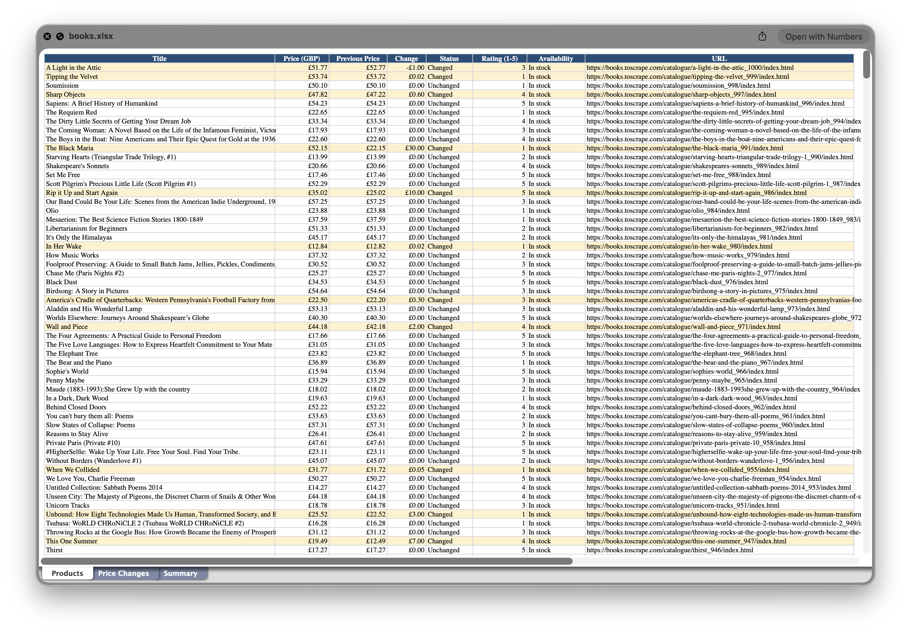
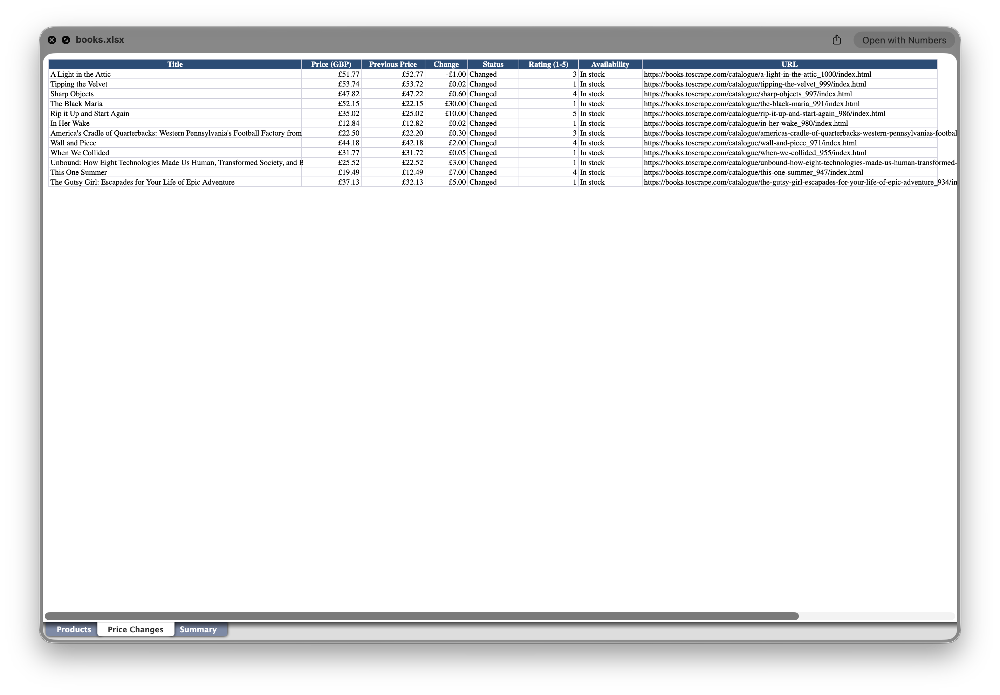
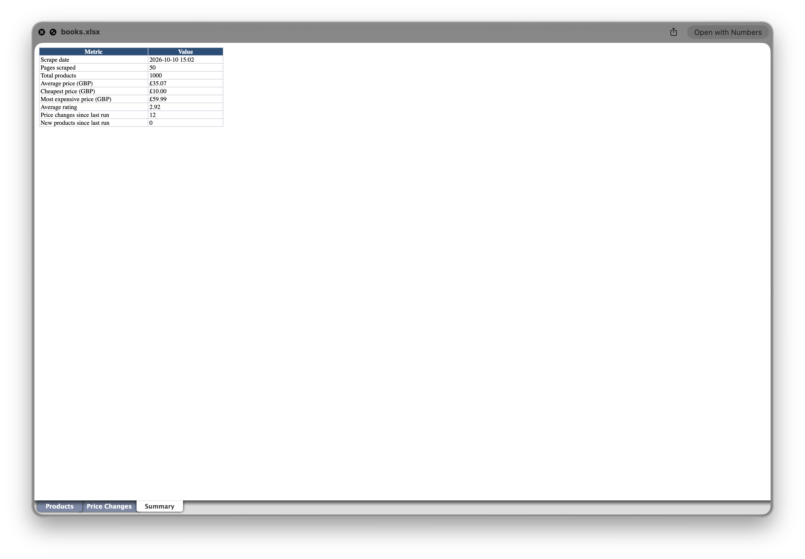

# Multi-Page Web Scraper: Exports Product Data to Excel

A Python scraper that collects product names, prices, ratings and availability
from every page of [books.toscrape.com](https://books.toscrape.com) (a site made
for scraping practice) and exports a formatted Excel workbook.

## Screenshots





## Features

- Follows pagination automatically (50 pages, 1,000 products)
- Retries failed requests with backoff; logs errors instead of crashing
- Saves partial results if a page fails permanently
- Compares prices with the previous run and highlights changes
- Excel output with three sheets: **Products**, **Price Changes**, **Summary**
- Command-line options for page limit, delay and output path

## Setup

```bash
python3 -m venv venv
source venv/bin/activate
pip install -r requirements.txt
```

## Usage

```bash
python scraper.py                   # scrape everything
python scraper.py --max-pages 3     # quick test
python scraper.py --output report.xlsx --delay 1
```

Output goes to `output/books.xlsx`. A log is written to `scraper.log`.

## How price-change detection works

After each run, prices are saved to `data/price_history.json`. On the next run,
every product is compared against that file. Each row gets a **Status**
(`First run`, `New`, `Changed` or `Unchanged`). Changed rows are highlighted in
yellow on the **Products** sheet and copied to the **Price Changes** sheet.

## Tech

Python, Requests, BeautifulSoup, pandas, openpyxl.

## Note

Built as a personal sample project. The target site is a public practice site
that permits scraping. When scraping real sites, always check the site's
terms of service and robots.txt first.
